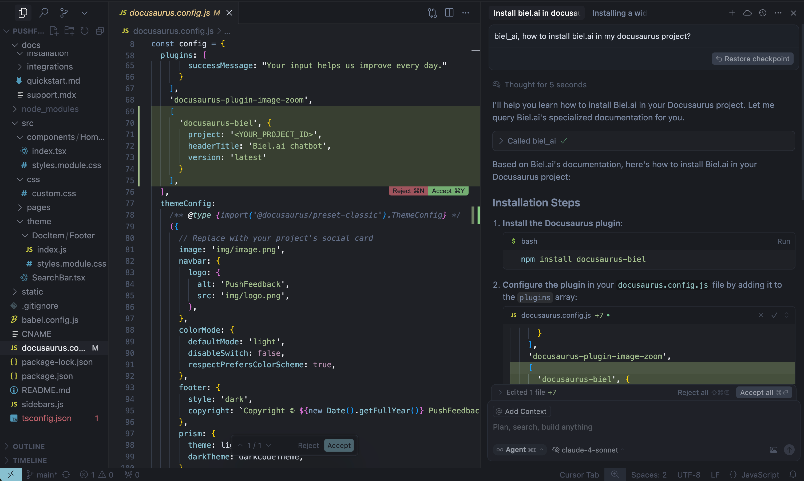

<div align="center">
  <picture>
    <source media="(prefers-color-scheme: dark)" srcset="./logo-dark.png" />
    
  </picture>
  <h1>Biel.ai MCP Server</h1>
  <h3>Give AI assistants context from technical documentation</h3>
</div>

[Biel.ai](https://biel.ai) turns technical documentation into answers for users and context for AI agents, with links back to the sources. This MCP server connects Claude Code, Codex, Cursor, and other compatible clients to documentation indexed in a Biel.ai project.

The usual workflow is to search for relevant content, retrieve indexed documents when more context is needed, and answer in the calling AI assistant. Biel.ai can also generate an answer when you explicitly request one. Source grounding does not eliminate model error; check the retrieved content and references.



> Requires a Biel.ai account, indexed sources, and hosted MCP enabled on a plan that includes it. [Create an account](https://app.biel.ai/accounts/signup/) and follow the [MCP setup guide](https://docs.biel.ai/integrations/mcp-server).

## Getting started

### 1. Enable MCP and copy your endpoint

Open your project in Biel.ai, go to **Settings** > **MCP**, enable the MCP server, and save. Copy the complete endpoint supplied for your project. 

### 2. Connect your AI client

Use the canonical documentation for client-specific steps:

- [Connect technical documentation to Claude Code](https://docs.biel.ai/integrations/mcp-server#connect-technical-documentation-to-claude-code).
- [Connect technical documentation to Codex](https://docs.biel.ai/integrations/mcp-server#connect-technical-documentation-to-codex).
- [Connect ChatGPT](https://docs.biel.ai/integrations/chatgpt-plugin) or [Claude](https://docs.biel.ai/integrations/claude-connector).
- For Cursor and VS Code / Copilot, use the widget's **Connect** menu or the [manual setup guide](https://docs.biel.ai/integrations/mcp-server#manual-configuration).

The [example configuration](./example-mcp.json) uses `mcp-remote` as a bridge for clients without native Streamable HTTP support. Clients with native HTTP support should connect directly using their own configuration format.

### 3. Verify retrieval

Confirm the client discovers `biel_search`, `biel_get_document`, and `biel_ai`. Ask a question your indexed documentation covers:

```text
Use biel_search to find our API authentication instructions. Read relevant
results with biel_get_document and explain the required headers with source links.
```

Check the retrieved text and citations against the documentation. MCP serves indexed content; refresh sources in Biel.ai after documentation changes and search again for current document IDs.

## Choose generated answers or search

The server exposes three tools:

- `biel_ai`: ask Biel.ai to generate an answer, with conversational context. Existing calls using `message` continue to generate answers.
- `biel_search`: hybrid keyword and semantic search over indexed web pages, uploaded files, repositories and OpenAPI sources, without answer generation.
- `biel_get_document`: read the complete indexed text of a document returned by search.

Call `biel_search` with a natural-language question or search terms:

```json
{"query": "How do I authenticate with the SDK?", "limit": 5}
```

Search requests the API's `search_type=hybrid&source_types=all`. The REST API defaults to `search_type=keyword`, independently of the selected sources. Results include chunk text, source type, a `document_id`, and any page/sheet reference; non-URL documents are cited by title and location. The `limit` argument controls how many chunks are returned (default 5, maximum 20).

Use `biel_get_document` with a search result's `document_id` to read the complete indexed document without visiting its source site:

```json
{"document_id": "DOCUMENT_ID_FROM_SEARCH", "limit": 20}
```
## Troubleshooting

Public projects do not need an API key. Private projects require an `api_key` query parameter with `search` permission for retrieval and `chats_create` for generated answers. 

A `domain` query parameter is needed when allowed domains are configured. See [connection parameters](https://docs.biel.ai/integrations/mcp-server#configuration-parameters) before connecting a private or domain-restricted project. Treat a URL containing a key as a credential and keep it out of shared configuration.

## Self-hosting (Optional)

For advanced users who prefer to run their own MCP server instance:

Self-hosted servers default to loopback access. Configure `BIEL_ALLOWED_HOSTS`
with the explicit hostnames clients use and `BIEL_ALLOWED_ORIGINS` with exact
browser origins; requests without Origin remain supported. Wildcard Host/Origin
allowlists are rejected. Set `BIEL_BIND_HOST` explicitly for remote access and
`FORWARDED_ALLOW_IPS` only for trusted proxy peers. Upstream API destinations
remain a separate `BIEL_ALLOWED_BASE_URLS` policy. Django hosts supply their own
`TransportPolicy` when mounting the app.

### Local development
```bash
# Clone and run locally
git clone https://github.com/TechDocsStudio/biel-mcp
cd biel-mcp
pip install .
biel-mcp
```

### Use as a Python package

Applications that host their own ASGI stack can install the server directly
from a tagged revision and import its FastAPI application:

```bash
pip install "biel-mcp @ git+https://github.com/TechDocsStudio/biel-mcp.git@VERSION"
```

```python
from biel_mcp.server import app
```

### Docker deployment

```bash
# Docker Compose (recommended)
docker-compose up -d --build

# Or Docker directly
docker build -t biel-mcp .
docker run -d -p 127.0.0.1:7832:7832 -e BIEL_BIND_HOST=0.0.0.0 biel-mcp
```

## Support

- **Issues**: [GitHub Issues](https://github.com/techdocsStudio/biel-mcp/issues)
- **Contact**: [support@biel.ai](mailto:support@biel.ai)
- **Custom Demo**: [Book a demo](https://biel.ai/contact)
