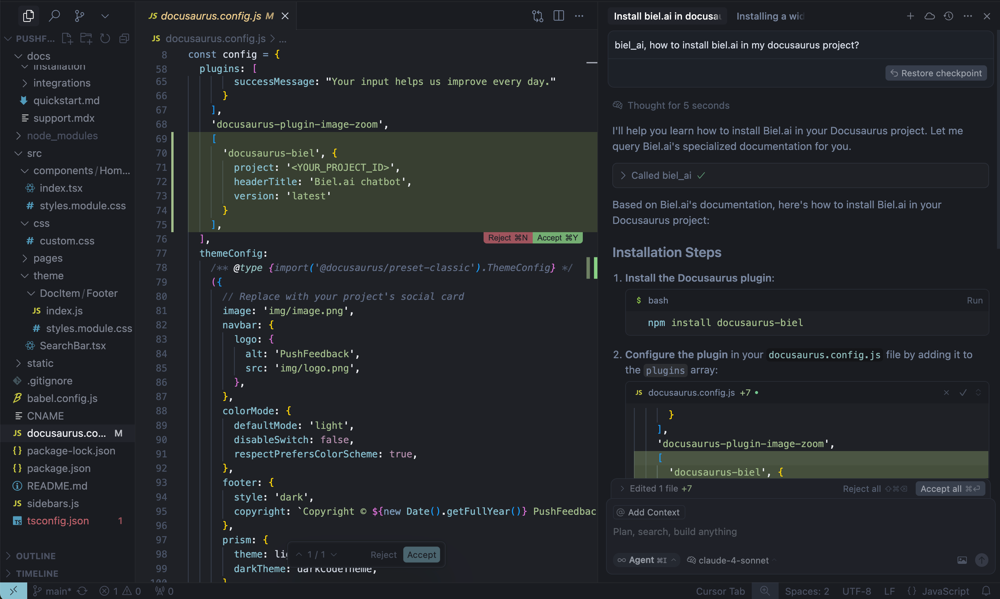

<div align="center">
  <picture>
    <source media="(prefers-color-scheme: dark)" srcset="./logo-dark.png" />
    
  </picture>
  <h1>Biel.ai MCP Server</h1>
  <h3>Give AI assistants context from technical documentation</h3>
</div>

[Biel.ai](https://biel.ai) turns technical documentation into answers for users and context for AI agents, with links back to the sources. This MCP server connects Claude Code, Codex, Cursor, and other compatible clients to documentation indexed in a Biel.ai project.

The usual workflow is to search for relevant content, retrieve indexed documents when more context is needed, and answer in the calling AI assistant. Biel.ai can also generate an answer when you explicitly request one. Check the retrieved content and references when using a generated answer.



> Requires a Biel.ai account, indexed sources, and hosted MCP enabled on a plan that includes it. [Create an account](https://app.biel.ai/accounts/signup/) and follow the [MCP setup guide](https://docs.biel.ai/integrations/mcp-server).

## Getting started

### 1. Enable MCP and copy your endpoint

Open your project in Biel.ai, go to **Settings** > **MCP**, enable the MCP server, and save. Copy the complete endpoint supplied for your project.

### 2. Connect your AI client

Use the canonical documentation for client-specific steps:

- For Claude Code and Codex, use the [manual setup guide](https://docs.biel.ai/integrations/mcp-server#manual-configuration) and your client's HTTP configuration format.
- [Connect ChatGPT](https://docs.biel.ai/integrations/chatgpt-plugin) or [Claude](https://docs.biel.ai/integrations/claude-connector).
- For Cursor and VS Code / Copilot, use the widget's **Connect** menu or the [manual setup guide](https://docs.biel.ai/integrations/mcp-server#manual-configuration).

The [example configuration](./example-mcp.json) uses `mcp-remote` as a bridge for clients without native Streamable HTTP support. Clients with native HTTP support should connect directly using their own configuration format.

### 3. Verify retrieval

Confirm the client discovers `biel_search`, `biel_get_document`, and `biel_ai`. Ask a question your indexed documentation covers:

```text
Use biel_search to find our API authentication instructions. Read relevant
results with biel_get_document and explain the required headers with source links.
```

Check the retrieved text and citations against the documentation. MCP serves indexed content; refresh sources in Biel.ai after documentation changes and search again for current document IDs.

## Choose generated answers or search

The server exposes three tools:

- `biel_ai`: ask Biel.ai to generate an answer, with conversational context. Existing calls using `message` continue to generate answers.
- `biel_search`: hybrid keyword and semantic search over indexed web pages, uploaded files, repositories and OpenAPI sources, without answer generation.
- `biel_get_document`: read the complete indexed text of a document returned by search.

Call `biel_search` with a natural-language question or search terms:

```json
{"query": "How do I authenticate with the SDK?", "limit": 5}
```

Search requests the API's `search_type=hybrid&source_types=all`. The REST API defaults to `search_type=keyword`, independently of the selected sources. Results include chunk text, source type, a `document_id`, and any page or sheet reference. Documents without a URL are cited by title and location. The `limit` argument controls how many chunks are returned (default 5, maximum 20).

Use `biel_get_document` with a search result's `document_id` to read the complete indexed document without visiting its source site:

```json
{"document_id": "DOCUMENT_ID_FROM_SEARCH", "limit": 20}
```

## Continue a generated conversation

Streamable HTTP clients using MCP protocol `2025-11-25` or earlier continue the same `biel_ai` chat within a connection. The client sends the `Mcp-Session-Id` returned during initialization automatically. Reconnecting starts a new conversation.

Clients using protocol `2026-07-28` do not initialize a session. Call `biel_ai` without `conversation_id` to start a conversation:

```json
{"message": "How do I authenticate with the SDK?"}
```

The result includes an opaque conversation ID in its text and in `structuredContent.conversation_id`. Pass that value on the next call:

```json
{"message": "Can I rotate that credential?", "conversation_id": "CONVERSATION_ID_FROM_PREVIOUS_RESULT"}
```

Use the same project endpoint, API key and Biel backend. Omitting `conversation_id` starts a new conversation. An expired or invalid identifier returns a tool error. Search and document reads do not create or change a conversation.

Conversation state expires after 15 minutes of inactivity with the default timeout. Self-hosted servers retain it for the configured read timeout plus five minutes. Treat a conversation ID as a private identifier. Never supply an API chat UUID or a restore token.

## Troubleshooting

Public projects do not need an API key. Private projects require an `api_key` query parameter with `search` permission for retrieval and `chats_create` for generated answers.

A `domain` query parameter is needed when allowed domains are configured. See [connection parameters](https://docs.biel.ai/integrations/mcp-server#configuration-parameters) before connecting a private or domain-restricted project. Treat a URL containing a key as a credential and keep it out of shared configuration.

## Self-hosting (optional)

Use Python 3.10 or later. The server uses `MCPServer` from the official Python MCP SDK 2.3.

Streamable HTTP is available at `/mcp/PROJECT_SLUG` and `/v2/PROJECT_SLUG/mcp`. Existing hosted endpoint configurations continue to work. Legacy SSE remains available at `/sse?project_slug=PROJECT_SLUG`. Its client follows the `/messages/` endpoint announced by the server.

Run standalone SSE with one process. Its live connection belongs to that process. For an HTTP deployment with multiple workers, provide shared session and conversation storage through the application factory. The Django integration uses its shared cache. The standalone default stores this state in memory, so restarting it loses conversations.

### Local development

```bash
# Clone and run locally
git clone https://github.com/TechDocsStudio/biel-mcp
cd biel-mcp
pip install .
biel-mcp
```

Install the test dependencies and run the package tests:

```bash
pip install '.[test]'
python -m unittest discover -s tests -v
```

### Use as a Python package

Applications that host their own ASGI stack can install a released revision and import its ASGI application:

```bash
pip install "biel-mcp @ git+https://github.com/TechDocsStudio/biel-mcp.git@VERSION"
```

```python
from biel_mcp.server import app
```

Use `create_app()` from the same module for an independent application instance. Pass `store` and `conversation_store` for shared state, `api_base_url` for the backend origin, and `enable_sse=False` when serving only Streamable HTTP.

Uvicorn starts the application's ASGI lifespan automatically. When mounting it inside another ASGI application, the host must enter `app.router.lifespan_context(app)` during startup and exit it during shutdown. Mounting an HTTP subapplication does not start its resources automatically.

Set `BIEL_BASE_URL` to select your Biel backend when running the CLI. `BIEL_ALLOWED_BASE_URLS` is a comma-separated list of backend origins the operator allows. A client-supplied `base_url` must match that list. `BIEL_MCP_READ_TIMEOUT_SECONDS` sets the upstream read timeout, with a default of 600 seconds.

### Docker deployment

```bash
# Docker Compose (recommended)
docker compose up -d --build

# Or Docker directly
docker build -t biel-mcp .
docker run -d -p 7832:7832 biel-mcp
```

## Support

- **Issues**: [GitHub Issues](https://github.com/techdocsStudio/biel-mcp/issues)
- **Contact**: [support@biel.ai](mailto:support@biel.ai)
- **Custom Demo**: [Book a demo](https://biel.ai/contact)
